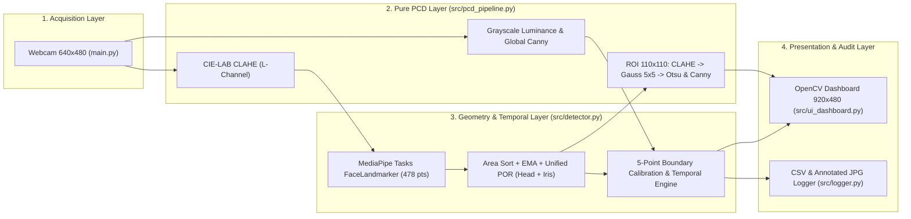
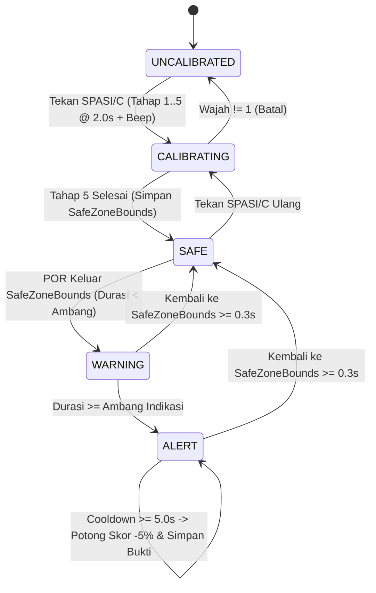

# SYSTEM ARCHITECTURE & CORE INVARIANTS
# Sistem Deteksi Indikasi Kecurangan Ujian Online Berbasis Citra Digital (Mode 1: CBT Paperless)

Dokumen ini mendefinisikan batas modul, *invariants* teknis, aliran data, *state machine* kalibrasi 5 titik, dan pemodelan *Unified Point-of-Regard (POR)*. Untuk daftar angka ambang batas dan persamaan lengkap, rujuk sumber kebenaran tunggal di [PRD.md](./PRD.md).

---

## 1. Core Architectural Invariants (Aturan Mati Sistem)
1. **Unidirectional Pure Pipeline:** Pemrosesan citra di `src/pcd_pipeline.py` dan kalkulasi geometri di `src/detector.py` dirancang sebagai fungsi bebas I/O (*pure/testable functions*) sehingga seluruh logika dapat diuji tanpa perangkat keras kamera di `tests/test_detector_logic.py`.
2. **Monotonic Video Timestamps & Non-Blocking Audio:** Seluruh perhitungan durasi wajib menggunakan `time.monotonic()`, `FaceMeshDetector.detect_faces` menjamin `timestamp_ms` naik ketat (`strictly increasing`), dan bunyi transisi kalibrasi dijalankan pada *daemon thread* agar tidak menghambat *frame rate* video.
3. **Zero Frame-Drop Loop:** Objek berat (`CLAHE`, `FaceLandmarker`, `EvidenceLogger`) hanya diinisialisasi satu kali di luar `while cap.isOpened():`. Penulisan log CSV menggunakan modul standar `csv` dengan `with open(...)`.
4. **Urutan Prioritas Deterministik:** Evaluasi per-frame selalu memproses anomali lingkungan/kamera terlebih dahulu sebelum batas zona pandang `SafeZoneBounds`:
   `IND-05 (Gelap/Oklusi)` $\rightarrow$ `IND-03 (>1 Wajah)` $\rightarrow$ `IND-04 (0 Wajah)` $\rightarrow$ `IND-01 (POR_x Kiri/Kanan)` $\rightarrow$ `IND-02 (POR_y Atas/Touchpad)` $\rightarrow$ `NORMAL`.

---

## 2. Aliran Data Berlapis & Kontrak Modul (SRP)

| Modul | Tanggung Jawab Tunggal | Ketergantungan Internal |
| :--- | :--- | :--- |
| `src/config.py` | Definisi `StrEnum`, `SafeZoneBounds`, `DetectorConfig`, dan state `MonitoringState`. | Tidak ada (*Leaf Module*) |
| `src/pcd_pipeline.py` | Transformasi matriks citra (Luminansi, LAB-CLAHE, Gaussian, Otsu, Canny). | `src/config.py` |
| `src/detector.py` | Ekstraksi 478 landmark, proyeksi gabungan `POR_x/POR_y`, kalibrasi 5 titik, & timer. | `src/config.py` |
| `src/logger.py` | Persistensi screenshot bukti ber-anotasi (`.jpg`) dan baris CSV (`.csv`). | `src/config.py` |
| `src/ui_dashboard.py` | Komposisi kanvas `920x480`, panah pemandu 5 arah kalibrasi, & Grid 2x2 PCD. | `config`, `detector`, `pcd_pipeline` |
| `main.py` | Koordinator siklus kamera, *daemon audio cue*, input keyboard, & *cleanup*. | Seluruh modul `src/` |

---

## 3. Proyeksi *Unified Point-of-Regard* & Kalibrasi 5 Titik Fisik

1. **Mengapa Kalibrasi 5 Titik Mengatasi Asimetri Layar?**
   Posisi jendela aplikasi, ukuran layar laptop (13"–16"), dan posisi duduk membuat kalibrasi 1 titik tengah menghasilkan jarak pemicu yang timpang antara sisi kiri, kanan, atas, dan bawah. Dengan merekam langsung 5 titik fisik (**Tengah $\rightarrow$ Tepi Kiri $\rightarrow$ Tepi Kanan $\rightarrow$ Bezel Atas $\rightarrow$ Akhir Touchpad**), sistem membangun persegi batas `SafeZoneBounds` yang mengikuti geometri fisik laptop peserta secara eksak (`~1 cm` di luar tepi kiri/kanan/atas layar dan tepat di titik akhir bawah touchpad).
2. **Fusi Kepala + Bola Mata (`compute_point_of_regard`):**
   Koordinat `POR_x` dan `POR_y` menjumlahkan pergeseran bola mata dengan kontribusi rotasi kepala (`Yaw` & `Pitch`). Hasilnya:
   - Baik lirikan mata murni (kepala diam) maupun tolehan/anggukan kepala (atau kombinasi keduanya) sama-sama memicu status **Kuning (`MEMANTAU`)** tepat saat melewati batas fisik.
   - Saat dagu bergerak sedikit namun mata mengompensasi ke arah berlawanan agar tetap menatap layar (*Vestibulo-Ocular Reflex*), kedua komponen saling meniadakan sehingga area layar tetap **Hijau (`AMAN`)**.

---

## 4. Kesiapan Ekstensi Masa Depan (*Mode 2: Ujian Coret-Coret / Kertas Buram*)
Sesuai *Open/Closed Principle (OCP)*, pengembangan **Mode 2** cukup memperluas tahap ke-5 kalibrasi menjadi area kertas buram di meja atau mengaktifkan profil `ExamMode.SCRATCH_PAPER` pada `DetectorConfig` tanpa mengubah `src/pcd_pipeline.py` maupun `src/logger.py`.
