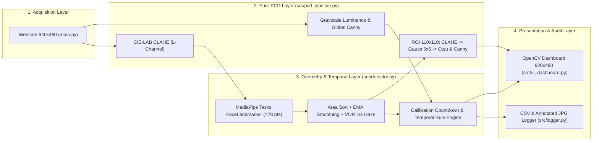
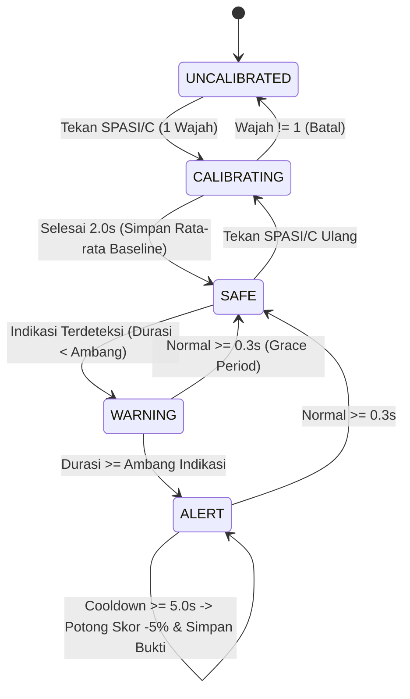

# SYSTEM ARCHITECTURE
# Sistem Deteksi Indikasi Kecurangan Ujian Online Berbasis Citra Digital (Mode 1: CBT Paperless)

## 1. Gambaran Arsitektur & Prinsip Desain
Sistem dirancang dengan arsitektur **Modular Pipeline satu arah (*Unidirectional Data Flow*)** yang memisahkan akuisisi perangkat keras, pemrosesan matriks citra murni (*Pure PCD*), ekstraksi geometri visi komputer, mesin aturan temporal (*Stateful Rule Engine*), pencatatan bukti I/O, dan lapisan presentasi UI.

---

## 2. Kontrak Tanggung Jawab Modul (SRP)

| Modul | Tanggung Jawab Tunggal | Ketergantungan Internal |
| :--- | :--- | :--- |
| `src/config.py` | Menyimpan `StrEnum` kode indikasi, konstanta ambang batas (`DetectorConfig`), serta struktur data sesi (`MonitoringState`). | Tidak bergantung pada modul `src/` lain (*Leaf Module*). |
| `src/pcd_pipeline.py` | Fungsi matematis murni pengolahan citra digital tanpa efek samping I/O maupun state global. | `src/config.py` |
| `src/detector.py` | Pembungkus `vision.FaceLandmarker`, pengurutan luas wajah, kalkulasi *Head Pose* + *Iris Gaze* berkompensasi VOR, kalibrasi hitung mundur, dan mesin waktu temporal. | `src/config.py` |
| `src/logger.py` | Penulisan bukti foto `.jpg` dan baris `log_indikasi_ujian.csv` memakai *context manager* standar. | `src/config.py` |
| `src/ui_dashboard.py` | Merender matriks piksel kanvas `920x480` beserta penanda wajah/iris, target kalibrasi, dan Grid 2x2 PCD. | `src/config.py`, `src/detector.py`, `src/pcd_pipeline.py` |
| `main.py` | Orkestrasi *event loop* kamera, penanganan input tombol (`SPASI`/`C`, `R`, `Q`), dan pelepasan *resource* (`try...finally`). | Seluruh modul `src/` |

---

## 3. Konvensi Sistem Koordinat & Kompensasi Ergonomi Layar

1. **Ruang Citra Tercermin (*Mirrored Image Space*):**
   - Setelah `cv2.flip(frame, 1)`, sumbu $X$ bernilai `0.0` di sisi kiri layar peserta hingga `1.0` di sisi kanan layar peserta; sumbu $Y$ bernilai `0.0` di atas hingga `1.0` di bawah.
2. **Masalah Ergonomi Kalibrasi Tombol (*Keyboard Gaze Trap*) & Solusinya:**
   - Menekan tombol huruf pada papan ketik memicu peserta menundukkan mata sesaat. Pengambilan sampel kalibrasi instan menyebabkan sistem merekam **sudut keyboard** sebagai titik tengah.
   - **Solusi Arsitektural:** Sistem menggunakan **2.0 Detik Hitung Mundur Visual** dengan titik bidik di `(320, 240)` dan merata-ratakan sampel hanya pada jendela `0.8 detik` terakhir saat mata sudah stabil menatap tengah layar.
3. **Kompensasi *Vestibulo-Ocular Reflex* (VOR) pada Mata Vertikal:**
   - Saat dagu peserta sedikit turun ($\Delta\text{Pitch} > 0$) namun fokus mata tetap menempel pada layar laptop, bola mata secara biologis berputar naik di dalam kelopak ($\Delta\text{Gaze}_y < 0$).
   - Agar seluruh permukaan layar laptop tetap berada di **Zona Hijau (`AMAN`)**, deviasi vertikal mata dikompensasi terhadap perubahan sudut kepala:
     $$\text{Gaze}_{y,\text{comp}} = \text{Gaze}_{y} + k_{\text{VOR}} \cdot (\text{Pitch} - \text{Baseline}_{\text{pitch}}), \quad k_{\text{VOR}} = 0.80$$

---

## 4. Mesin Keadaan (*Finite State Machine*) Pemantauan

---

## 5. Penanganan Kegagalan (*Failure Modes & Resilience*)
- **Timestamp Non-Monotonik MediaPipe:** `FaceMeshDetector.detect_faces` memaksa `timestamp_ms` selalu naik minimal `+1 ms` agar graf C++ `RunningMode.VIDEO` tidak melempar `ValueError`.
- **Kedipan Alami (*Blink Noise*):** Jika *Eye Aspect Ratio* ($\text{EAR} < 0.15$), evaluasi *Iris Gaze* dilewati pada frame tersebut sehingga kedipan mata tidak memicu peringatan palsu.
- **Kegagalan Kamera / Model:** Ketiadaan webcam atau kegagalan unduh `models/face_landmarker.task` dihentikan di awal dengan pesan `RuntimeError` terstruktur dan pembersihan file `.tmp`.

---

## 6. Titik Perluasan Masa Depan (*Mode 2: Ujian Hitungan / Kertas Coretan*)
Sesuai prinsip *Open/Closed (OCP)*, pengembangan **Mode 2** kelak cukup menambahkan profil `ExamMode.SCRATCH_PAPER` pada `DetectorConfig` (melonggarkan `tol_pitch` bawah dan `thresh_pitch_sec` saat peserta menulis di kertas buram) tanpa mengubah `src/pcd_pipeline.py` maupun `src/logger.py`.
