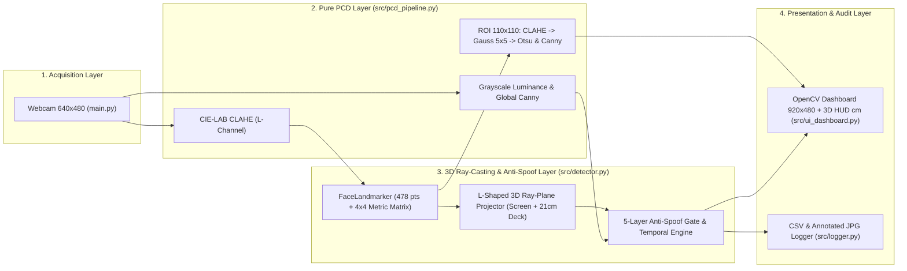
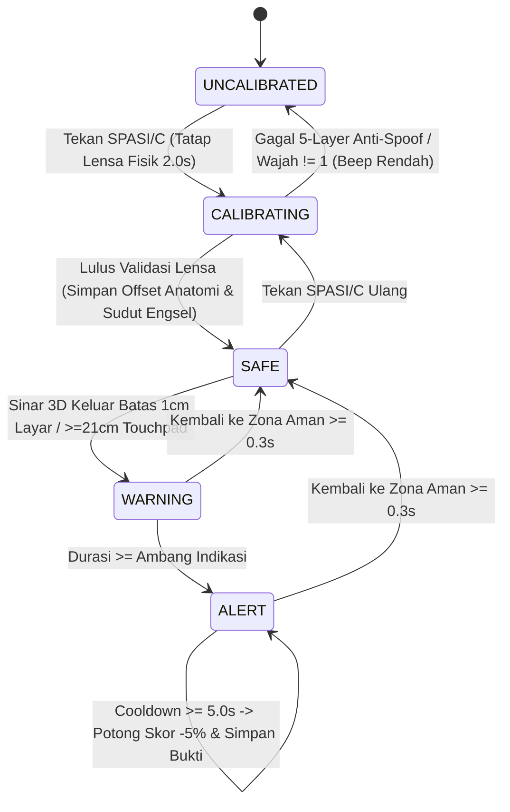

# SYSTEM ARCHITECTURE & CORE INVARIANTS
# Sistem Deteksi Indikasi Kecurangan Ujian Online Berbasis Citra Digital (Mode 1: CBT Paperless)

Dokumen ini mendefinisikan batas modul, *invariants* keamanan Anti-Spoof, aliran data, *state machine*, dan geometri *L-Shaped 3D Gaze Ray-Casting*. Untuk angka ambang batas lengkap, rujuk sumber kebenaran tunggal di [PRD.md](./PRD.md).

---

## 1. Core Architectural Invariants (Aturan Mati Sistem)
1. **Hardware-Locked Safe Zone (Zero User Boundary Spoofing):** Batas zona aman layar ($\pm 16.08\text{ cm}$ horizontal, $-1.0\text{ cm}$ bezel atas) dan titik akhir bawah touchpad ($21.0\text{ cm}$ dari engsel) dikunci pada `DetectorConfig`. Peserta ujian **tidak pernah** menginput batas tepi, sehingga mustahil memperlebar zona aman (*immune to calibration poisoning*).
2. **Unidirectional Pure Pipeline:** Pemrosesan citra di `src/pcd_pipeline.py` dan proyeksi sinar 3D di `src/detector.py` bebas efek samping I/O sehingga dapat diuji deterministik di `tests/test_detector_logic.py`.
3. **Monotonic Timestamps & Non-Blocking Audio:** Seluruh durasi wajib dihitung menggunakan `time.monotonic()`, `FaceMeshDetector` menjamin `timestamp_ms` naik ketat (`strictly increasing`), dan bunyi bip kalibrasi dijalankan di *daemon thread*.
4. **Urutan Prioritas Deterministik:**
   `IND-05 (Gelap/Oklusi)` $\rightarrow$ `IND-03 (>1 Wajah)` $\rightarrow$ `IND-04 (0 Wajah)` $\rightarrow$ `IND-01 (|X_hit| > 16.08 cm)` $\rightarrow$ `IND-02 (Y_scr < -1.0 cm atau Deck_Z >= 21.0 cm)` $\rightarrow$ `NORMAL`.

---

## 2. Aliran Data Berlapis & Kontrak Modul (SRP)

| Modul | Tanggung Jawab Tunggal | Ketergantungan Internal |
| :--- | :--- | :--- |
| `src/config.py` | Definisi `StrEnum`, dimensi fisik laptop `DetectorConfig`, `CalibrationSample`, & `MonitoringState`. | Tidak ada (*Leaf Module*) |
| `src/pcd_pipeline.py` | Transformasi matriks citra (Luminansi, LAB-CLAHE, Gaussian, Otsu, Canny). | `src/config.py` |
| `src/detector.py` | Matriks 3D `FaceLandmarker`, proyeksi sinar bentuk-L (`project_gaze_3d`), Anti-Spoof Gate, & timer. | `src/config.py` |
| `src/logger.py` | Persistensi screenshot bukti ber-anotasi (`.jpg`) dan baris CSV (`.csv`). | `src/config.py` |
| `src/ui_dashboard.py` | Kanvas `920x480`, panduan Lensa Kamera, HUD 3D (`cm`), & Grid 2x2 PCD. | `config`, `detector`, `pcd_pipeline` |
| `main.py` | Koordinator siklus kamera, *daemon audio cue*, input keyboard, & *cleanup*. | Seluruh modul `src/` |

---

## 3. Geometri *L-Shaped 3D Laptop Ray-Casting* & *5-Layer Anti-Spoof*

1. **Mengapa Proyeksi 3D Bentuk-L (Layar Vertikal + Dek Keyboard Horizontal) Presisi ke Sentimeter?**
   Laptop terdiri dari dua bidang saling tegak lurus ($\sim 90^\circ\text{–}110^\circ$): bidang layar vertikal ($Z = 0$) dengan webcam di $(0, 0, 0)$, dan bidang papan ketik/touchpad horizontal ($Y = H_{\text{hinge}} = 20.2\text{ cm}$) yang memanjang mendekati tubuh peserta sejauh $21.0\text{ cm}$. Saat pandangan peserta turun melewati engsel bawah layar, sinar 3D memotong bidang horizontal dek pada jarak $Z_{\text{deck}}$ dari engsel sehingga batas ujung akhir touchpad ($Z_{\text{deck}} \ge 21.0\text{ cm}$) terukur presisi dalam sentimeter nyata, serta invarian terhadap pergeseran posisi duduk $(X_e, Y_e, Z_e)$.
2. **State Machine Kalibrasi Lensa & Pemantauan Temporal:**

---

## 4. Kesiapan Ekstensi Masa Depan (*Mode 2: Ujian Coret-Coret / Kertas Buram*)
Sesuai *Open/Closed Principle (OCP)*, pengembangan **Mode 2** cukup menambahkan parameter jangkauan kertas buram di atas meja (misal `desk_paper_depth_cm = 32.0`) pada `DetectorConfig` tanpa memodifikasi `src/pcd_pipeline.py` maupun `src/logger.py`.
